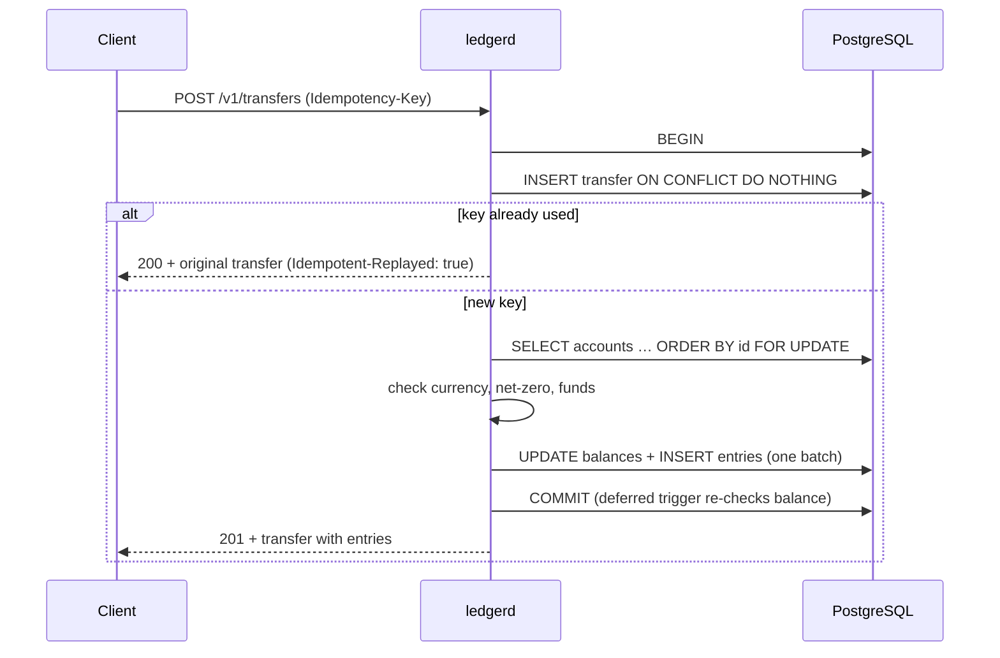

# ledgerd

[](https://github.com/Ahmedkholaif/ledgerd/actions/workflows/ci.yml)


A small **double-entry ledger service** in Go and PostgreSQL. It's the core you need under wallets, payouts, invoicing or marketplace balances. It's built so the books **can't** go wrong, even under heavy concurrency, client retries or someone running SQL by hand.

```
POST /v1/transfers            Idempotency-Key: order-8812
{ "postings": [ { "account_id": "…customer", "amount": -2500 },
                { "account_id": "…merchant", "amount":  2500 } ] }
```

## What it guarantees

| Guarantee | How |
|---|---|
| **Every transfer balances** | Postings must net to zero per currency. This is checked in Go for clear errors, *and* by a `DEFERRABLE` constraint trigger that runs at commit, so even raw SQL can't save an unbalanced transfer. |
| **No overdrafts** | Accounts lock with `SELECT … FOR UPDATE` before their balances are checked. A `CHECK` constraint backs this up in the database. |
| **No deadlocks** | Account rows are always locked in ascending ID order, so two transfers touching the same accounts can never wait on each other in a cycle. |
| **Exactly-once on retries** | A unique idempotency key is claimed with `INSERT … ON CONFLICT DO NOTHING`. Concurrent duplicates block on the index, then replay the original result. Reusing a key with a *different* body returns `409`. |
| **Append-only journal** | Triggers reject `UPDATE`/`DELETE` on entries and transfers. Corrections are new transfers. |
| **Provably consistent** | `GET /v1/audit` recomputes every balance from the journal and checks that each currency sums to zero across the ledger. |



## Tested under load

The test suite runs against a real PostgreSQL, with `-race` in CI. The interesting tests are:

- **`TestConcurrentTransfersPreserveInvariants`**: 32 goroutines send 1,280 random transfers between 8 accounts. Afterwards no account is negative, no money was created or destroyed, nothing deadlocked, and the audit is clean.
- **`TestConcurrentSameIdempotencyKey`**: 24 goroutines race with the same key. Exactly one transfer is created and all callers get the same ID.
- **`TestSchemaEnforcesInvariants`**: bypasses the Go code entirely and shows the database itself rejects edits, deletes, unbalanced transfers and overdrafts.

## Run it

```bash
docker compose up --build          # Postgres + ledgerd on :8080
```

```bash
# create two accounts
W=$(curl -s localhost:8080/v1/accounts -d '{"name":"world","currency":"USD","allow_negative":true}' | jq -r .id)
A=$(curl -s localhost:8080/v1/accounts -d '{"name":"alice","currency":"USD"}' | jq -r .id)

# move $25.00 — run it twice: the second call is a replay, not a second payment
curl -s localhost:8080/v1/transfers -H 'Idempotency-Key: topup-1' \
  -d "{\"description\":\"top-up\",\"postings\":[{\"account_id\":\"$W\",\"amount\":-2500},{\"account_id\":\"$A\",\"amount\":2500}]}"

curl -s localhost:8080/v1/accounts/$A          # balance: 2500
curl -s localhost:8080/v1/audit                # {"consistent":true,"mismatches":[]}
```

Tests: `docker compose up -d postgres && make test`

## API

| Method | Path | Notes |
|---|---|---|
| `POST` | `/v1/accounts` | `{name, currency, allow_negative}`. Amounts are integer minor units. |
| `GET` | `/v1/accounts?limit=` | All accounts in creation order |
| `GET` | `/v1/accounts/{id}` | Current balance |
| `GET` | `/v1/accounts/{id}/entries?after=&limit=` | Journal with keyset pagination |
| `POST` | `/v1/transfers` | Needs an `Idempotency-Key` header. Returns `201` when new, or `200` with `Idempotent-Replayed: true` on a replay |
| `GET` | `/v1/transfers/{id}` | Transfer with its entries |
| `GET` | `/v1/audit` | Full reconciliation |

Errors look like `{"error":{"code":"insufficient_funds","message":"…"}}`. The codes are `invalid_request` (422), `not_found` (404), `insufficient_funds` (409) and `idempotency_conflict` (409).

**Multi-currency:** a transfer must balance *within* each currency. An FX conversion is one transfer through per-currency clearing accounts (see `TestRejectsUnbalancedAndMixedCurrency`).

## Layout

```
cmd/ledgerd/          server, config, graceful shutdown
internal/ledger/      domain logic, SQL, embedded migrations (advisory-locked)
internal/api/         JSON HTTP API (Go 1.22+ routing)
```
